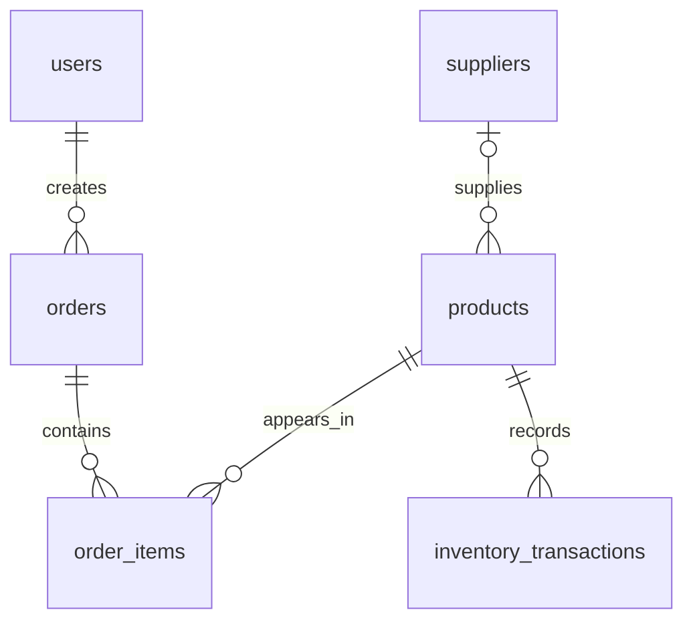

# Inventory Management System schema

This reference describes the actual `inventory_management_system` schema exported from the Mac on October 27, 2026 using PostgreSQL 18.6. All application objects are in `public`: **6 tables, 6 identity sequences, 6 views, 11 functions, and 4 triggers**. The export contains definitions and permissions, with no table records. It supersedes the separate four-table `inventory`-schema starter as the source for this repository.

The baseline preserves the exported business behavior and maps object ownership from `postgres` to the non-login `inventory_owner`. Original grants and revokes are recorded separately. V002 hardens function search paths and qualifies stock-operation table names. The permissions template prevents public creation of objects in `public`. None of this changes the working database on the Mac.

## Data dictionary

Every primary key below is an `integer GENERATED ALWAYS AS IDENTITY`. Each has its own sequence named `<table>_<column>_seq`, starting at 1. Omit identity columns when inserting new records. `timestamp` below means `timestamp without time zone`; a default does not imply `NOT NULL` unless the column is marked required.

### `users`

| Column | Type | Required | Default or constraint |
|---|---|---|---|
| `user_id` | integer | Yes | Identity primary key |
| `username` | varchar(50) | Yes | Unique; must contain non-whitespace text |
| `password_hash` | varchar(255) | Yes | Must contain non-whitespace text |
| `role` | varchar(30) | Yes | `SUPER_USER`, `INVENTORY_MANAGER`, or `PRODUCT_MANAGER` |
| `first_name` | varchar(50) | No | — |
| `last_name` | varchar(50) | No | — |
| `email` | varchar(100) | No | Unique when non-null |
| `is_active` | boolean | Yes | `true` |
| `created_at` | timestamp | Yes | `CURRENT_TIMESTAMP` |
| `updated_at` | timestamp | Yes | `CURRENT_TIMESTAMP`; no automatic update trigger |

### `products`

| Column | Type | Required | Default or constraint |
|---|---|---|---|
| `product_id` | integer | Yes | Identity primary key |
| `product_name` | varchar(100) | Yes | — |
| `description` | text | No | — |
| `sku` | varchar(50) | Yes | Unique |
| `quantity` | integer | Yes | `0`; nonnegative |
| `unit_price` | numeric(10,2) | Yes | Nonnegative check; see numeric limitation below |
| `reorder_level` | integer | Yes | `10`; nonnegative |
| `created_at` | timestamp | No | `CURRENT_TIMESTAMP` |
| `supplier_id` | integer | No | References `suppliers.supplier_id` |

### `suppliers`

| Column | Type | Required | Default or constraint |
|---|---|---|---|
| `supplier_id` | integer | Yes | Identity primary key |
| `supplier_name` | varchar(100) | Yes | — |
| `contact_person` | varchar(100) | No | — |
| `email` | varchar(100) | No | Unique when non-null |
| `phone` | varchar(20) | No | — |
| `address` | text | No | — |
| `created_at` | timestamp | No | `CURRENT_TIMESTAMP` |

### `inventory_transactions`

| Column | Type | Required | Default or constraint |
|---|---|---|---|
| `transaction_id` | integer | Yes | Identity primary key |
| `product_id` | integer | Yes | References `products.product_id` |
| `transaction_type` | varchar(20) | Yes | `IN`, `OUT`, or `ADJUSTMENT` |
| `quantity` | integer | Yes | Positive for `IN`/`OUT`; nonnegative for `ADJUSTMENT` |
| `transaction_date` | timestamp | No | `CURRENT_TIMESTAMP` |
| `notes` | text | No | — |

An `IN` transaction adds units, `OUT` removes units, and `ADJUSTMENT` sets the absolute quantity. The trigger applies the stock change before inserting the history row. A failed constraint or other error rolls back the statement's stock change as well.

### `orders`

| Column | Type | Required | Default or constraint |
|---|---|---|---|
| `order_id` | integer | Yes | Identity primary key |
| `created_by` | integer | Yes | References `users.user_id` |
| `order_date` | timestamp | Yes | `CURRENT_TIMESTAMP` |
| `total_amount` | numeric(12,2) | Yes | `0.00`; nonnegative check |
| `status` | varchar(20) | Yes | `PENDING`; allowed values also `COMPLETED`, `CANCELLED` |
| `notes` | text | No | — |
| `created_at` | timestamp | Yes | `CURRENT_TIMESTAMP` |

### `order_items`

| Column | Type | Required | Default or constraint |
|---|---|---|---|
| `order_item_id` | integer | Yes | Identity primary key |
| `order_id` | integer | Yes | References `orders.order_id` |
| `product_id` | integer | Yes | References `products.product_id` |
| `quantity` | integer | Yes | Positive |
| `unit_price` | numeric(10,2) | Yes | Nonnegative check; captured when item is added |

The pair `(order_id, product_id)` is unique. Adding the same product twice raises a uniqueness error; the function does not combine quantities.

## Relationships and history

The three order-related foreign keys explicitly restrict deletion. The product-to-supplier and transaction-to-product foreign keys use the default `NO ACTION` behavior; there are no cascading deletes. All foreign keys use default update behavior. There are six primary-key constraints and five unique constraints, which supply their indexes; the export has no additional explicit indexes.

Orders cannot be deleted. Finalized orders and their items cannot be modified through ordinary row operations. Inventory history cannot be updated or deleted; corrections use new transactions. These row triggers are not a substitute for restricting elevated owners, direct stock edits, or `TRUNCATE` access.

## Callable application functions

All seven application functions use `SECURITY DEFINER`. Call them using parameters and explicit `public.` qualification. Function return values are IDs or totals, not complete HTTP responses.

| Function and arguments | Returns | Behavior |
|---|---|---|
| `create_product(name varchar, sku varchar, description text, price numeric, reorder_level integer DEFAULT 10)` | integer | Creates a product at quantity zero; trims and validates name/SKU. |
| `update_product_details(product_id integer, name varchar, description text, price numeric, reorder_level integer)` | void | Updates name, description, price, and reorder level; does not change SKU, quantity, or supplier. |
| `record_stock_transaction(product_id integer, transaction_type varchar, quantity integer, notes text DEFAULT NULL)` | integer | Inserts stock history; its trigger changes quantity. |
| `create_pending_order(user_id integer, notes text DEFAULT NULL)` | integer | Requires an active `PRODUCT_MANAGER`; creates a pending order at total zero. |
| `add_order_item(order_id integer, product_id integer, quantity integer)` | integer | Locks the pending order, captures current product price, and inserts one item. |
| `complete_order(order_id integer)` | numeric | Locks the pending order, locks products in product-ID order, checks stock, records `OUT` transactions, calculates total, and completes the order. |
| `cancel_pending_order(order_id integer)` | void | Cancels only an existing pending order; no stock reversal is required because pending items have not deducted stock. |

Argument names in this table omit the SQL `p_` prefix for readability. The stored functions use that prefix. The actual types, argument order, defaults, and return types are shown.

### Order flow

Create a pending order, add its items, and then complete or cancel it. Stock is deducted at completion. Item prices are captured earlier, when added. The complete operation is atomic: stock transactions, stock quantities, order status, and total belong to the caller's transaction. An error must result in rollback before the backend reports failure or retries.

Use one backend transaction for the whole workflow when a partially assembled pending order is not wanted. Keep any returned order ID so a retry can check its state; completing an already completed order raises an error. There is no request-idempotency key for creating orders.

## Triggers and supporting functions

| Trigger | Table and timing | Function | Effect |
|---|---|---|---|
| `trg_update_inventory` | `inventory_transactions`, before insert | `update_inventory_quantity()` | Applies `IN`, `OUT`, or absolute `ADJUSTMENT`; rejects insufficient `OUT` stock. |
| `trg_protect_inventory` | `inventory_transactions`, before update/delete | `protect_inventory_history()` | Rejects edits and deletion of recorded stock history. |
| `trg_protect_orders` | `orders`, before update/delete | `protect_order_records()` | Rejects deletion, finalized-order changes, and changes to order identity/creator/timestamps. |
| `trg_protect_order_items` | `order_items`, before insert/update/delete | `protect_order_items()` | Locks the parent order; only pending items may change, and items cannot move between orders. |

All are row-level triggers. These four supporting functions return `trigger` and execute with invoker privileges. Applications use the seven functions above rather than invoking trigger functions directly.

## Views

| View | Output columns | Purpose |
|---|---|---|
| `inventory_summary` | `total_products`, `total_stock_quantity`, `total_inventory_value`, `low_stock_products`, `out_of_stock_products`, `healthy_stock_products` | Overall stock counts and value; low-stock count excludes zero stock. |
| `low_stock_report` | `product_id`, `product_name`, `sku`, `quantity`, `reorder_level`, `supplier_name`, `stock_status` | Products at or below reorder level, including zero stock. |
| `inventory_value_report` | `product_id`, `product_name`, `sku`, `quantity`, `unit_price`, `total_product_value`, `reorder_level`, `supplier_name`, `stock_status` | Product valuation and supplier context. |
| `order_history` | `order_id`, `order_date`, `created_by`, `status`, `total_line_items`, `total_units`, `total_amount`, `notes` | All order states with item/unit totals; `created_by` is the username. |
| `order_receipt` | `order_id`, `order_date`, `status`, `created_by`, `order_item_id`, `product_id`, `product_name`, `sku`, `quantity`, `unit_price`, `line_total`, `order_total` | Completed orders only; item prices are historical, names/SKUs/usernames are current. |
| `employee_order_summary` | `user_id`, `username`, `role`, `total_orders`, `completed_orders`, `pending_orders`, `completed_order_value` | Employee order counts and completed value; total count includes cancelled orders. |

## Backend integration and exported permissions

Database roles are distinct from employee role strings stored in `users.role`. The export records object grants but does not establish cluster-role attributes, passwords, memberships, or database-level connection policy.

| Database role | Exported object permissions | Intended integration |
|---|---|---|
| `inventory_java` | Select/insert/update `users`; sequence select/usage on all six identity sequences | Java authentication and employee administration. Keep password hashes inside the authentication service. No user-delete grant is exported. |
| `inventory_app` | Select on five non-user tables and all six views; execute all seven application functions | Python inventory queries, stock changes, order flow, and reports. No direct table writes or user-table read grant is exported. |
| `inventory_admin` | Select/insert/update/delete products, suppliers, and inventory transactions; select all six views; execute stock recording and order completion; sequence access for products/suppliers/transactions | Controlled administration. It is not the normal shared service account. History triggers still reject ordinary history update/delete. |
| `inventory_owner` | Owns published objects; non-login role | Migration ownership, replacing the raw export's `postgres` object owner. |

The exported ACLs revoke public execution of all eleven functions. Provision login passwords separately on each machine; no password or password hash belongs in the role templates. `inventory_java` has more sequence grants than its user-only work requires; those are retained for fidelity and can be narrowed in a later reviewed permission change.

## Known limitations and versioned hardening

- **Caller identity:** the database service account cannot identify the employee behind an HTTP request. Derive employee IDs from validated authentication, enforce employee and order permissions in the backend, and never trust an arbitrary submitted user ID. Only order creation checks active Product Manager status; add/complete/cancel functions do not recheck the employee or order ownership.
- **Function lookup:** the raw stock routines contain unqualified table names and omit `pg_temp` at the end of their search paths. V002 fixes these lookups and pins function search paths; the permissions template removes public schema creation rights. This follows PostgreSQL's [security-definer guidance](https://www.postgresql.org/docs/18/sql-createfunction.html#SQL-CREATEFUNCTION-SECURITY). The source database is unchanged until its administrator deliberately applies reviewed migrations.
- **Numeric validation:** nonnegative checks and the current price-validation functions allow PostgreSQL `numeric` NaN. Validate finite monetary values in the backend and add an explicit database constraint in a future migration. PostgreSQL documents that [numeric NaN sorts above ordinary numbers](https://www.postgresql.org/docs/18/datatype-numeric.html), so `value >= 0` alone does not reject it.
- **Usernames:** uniqueness is case-sensitive. Whitespace-only usernames fail, but leading/trailing whitespace is not automatically removed. Agree on authentication normalization before adding a case-insensitive unique index.
- **Audit fields:** `users.updated_at` only has an insertion default. There is no update timestamp trigger, stock-transaction employee ID, or stock-transaction foreign key to an order; completed-order references are stored in free-text notes.
- **Stock administration:** the administrative role can update product quantity directly, bypassing transaction history. Normal services should use `record_stock_transaction`. Supplier assignment and supplier maintenance are not exposed through the application's product functions.
- **History and time:** product names, SKUs, and usernames in views reflect current records. Only item unit price is snapshotted. Timestamps have no stored time zone; agree on a consistent application convention. Completed-order cancellation, refunds, and stock reversal are not implemented.
- **Errors and integration:** application exceptions generally use the default PL/pgSQL exception code; no stable domain-specific SQLSTATE contract is defined. This database export does not implement Spring Boot/FastAPI endpoints, authentication, or frontend role enforcement. Validate the full application separately.

These limitations describe the exported implementation. Preserve the baseline and use explicit subsequent migrations for behavioral changes.
